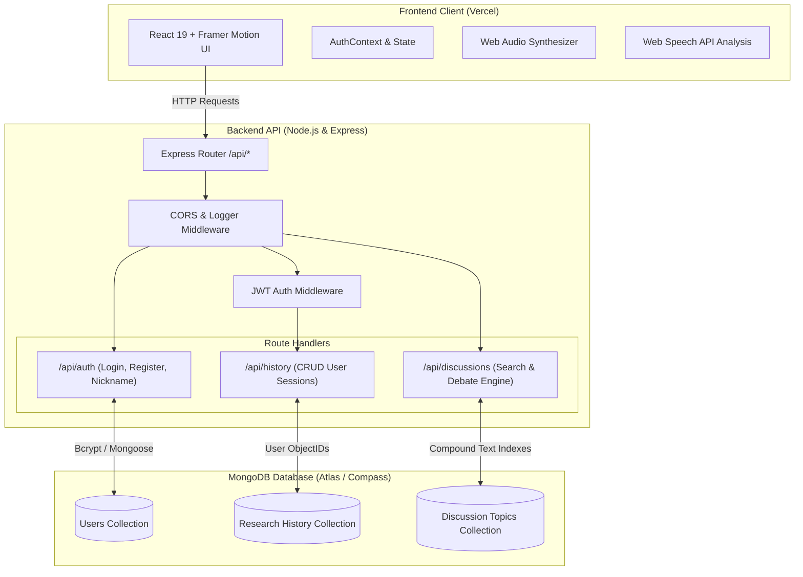
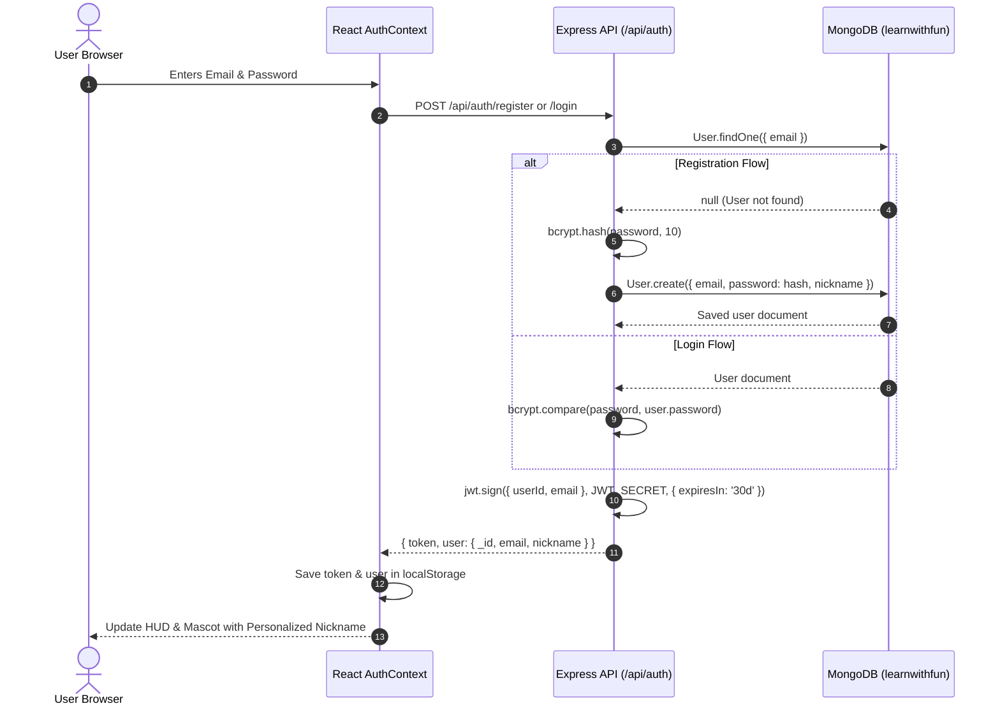

# 🎓 LearnWithFun — Retro Pixel Practice & Debate Platform

> **Live Production Website**: 🌐 **[https://exploreandlearn.vercel.app/](https://exploreandlearn.vercel.app/)**
> 
> *An interactive, retro-themed speech practice, debate exploration, and interview preparation platform powered by a **Node.js + Express** REST API and a **MongoDB** database.*

---

[](https://exploreandlearn.vercel.app/)
[](https://react.dev/)
[](https://nodejs.org/)
[](https://www.mongodb.com/)
[](LICENSE)

---

## 📑 Table of Contents

1. [🌟 Live Demo](#-live-demo)
2. [📖 Overview](#-overview)
3. [🏗️ Full-Stack Architecture](#️-full-stack-architecture)
4. [⚙️ How the Node.js & MongoDB Backend Works](#️-how-the-nodejs--mongodb-backend-works)
   - [1. Server Initialization & Resilience (`server.js`)](#1-server-initialization--resilience-serverjs)
   - [2. MongoDB Schemas & Data Modeling](#2-mongodb-schemas--data-modeling)
     - [User Model (`User.js`)](#a-user-model-servermodelsuserjs)
     - [Discussion Topic Model (`DiscussionTopic.js`)](#b-discussion-topic-model-servermodelsdiscussiontopicjs)
     - [Research History Model (`ResearchHistory.js`)](#c-research-history-model-servermodelsresearchhistoryjs)
   - [3. Authentication & Security Flow (`routes/auth.js`)](#3-authentication--security-flow-routesauthjs)
   - [4. Private Research History & Analytics (`routes/history.js`)](#4-private-research-history--analytics-routeshistoryjs)
   - [5. Debate Dataset & Search Engine (`routes/discussions.js`)](#5-debate-dataset--search-engine-routesdiscussionsjs)
   - [6. Hugging Face Dataset Ingestion Pipeline (`scripts/importDebateDataset.js`)](#6-hugging-face-dataset-ingestion-pipeline)
5. [🖥️ Frontend Client Architecture](#️-frontend-client-architecture)
6. [🔌 Complete REST API Reference](#-complete-rest-api-reference)
7. [🚀 Local Development Setup](#-local-development-setup)
8. [🌐 Environment Variables](#-environment-variables)
9. [☁️ Deployment Guide (Vercel + Cloud Backend)](#️-deployment-guide-vercel--cloud-backend)
10. [👨‍💻 Author & Acknowledgments](#-author--acknowledgments)

---

## 🌟 Live Demo

The application is deployed live and fully functional on Vercel:

👉 **[https://exploreandlearn.vercel.app/](https://exploreandlearn.vercel.app/)**

You can immediately:
- Practice speech topics with real-time timers and speech analysis.
- Pull the retro slot-machine lever to roll randomized interview, vocabulary, or debate prompts.
- Register an account or sign in to persist your personal nickname, avatar, and practice ratings.
- Search through thousands of curated debate discussions imported directly from research datasets.
- Test your speech delivery with live microphone pitch, pace, and filler-word detection.

---

## 📖 Overview

**LearnWithFun** (SpeechPact) is an educational, retro-arcade style learning platform designed to make public speaking, debate preparation, and vocabulary acquisition fun and structured. The project incorporates gamified audio synthesis (Web Audio API), animated pixel-art mascots, dynamic timer pacing, speech recognition, and robust cloud persistence.

### Key Highlights
- 🕹️ **Retro Pixel Aesthetic**: CRT scanline filters, arcade font typography, authentic 8-bit sound effects, and animated slot lever.
- 🦜 **Interactive Companion Mascot ("Vidhitam")**: Contextual speech bubbles that guide users through topics, encourage continuous practice, and track user stats.
- 🎤 **Speech Delivery Analysis**: Real-time microphone listening that analyzes duration, filler words (`um`, `uh`, `like`), pacing (words per minute), and vocabulary richness.
- ⚖️ **Curated Debate Hub**: Thousands of arguments and debate rounds indexed with compound text searches and categorized by topic depth and breadth.
- 🔐 **Dual Mode Access**: Instant one-click Guest Access or secure JWT-based registered accounts with full session history persistence.

---

## 🏗️ Full-Stack Architecture

The system follows a decoupled Client-Server architecture:



---

## ⚙️ How the Node.js & MongoDB Backend Works

The backend is built with **Node.js (ES Modules)**, **Express 4**, and **Mongoose 9** connected to **MongoDB**. It serves as a secure, high-performance RESTful API.

### 1. Server Initialization & Resilience (`server.js`)

The entry point [`server/server.js`](file:///c:/Users/Dell/OneDrive/Desktop/250780521060/server/server.js) initializes the application:

1. **Environment Configuration**: Loads environment variables from `.env` via `dotenv`.
2. **CORS Security**: Accepts requests from production (`https://exploreandlearn.vercel.app`), local Vite (`http://localhost:5173`), and curl/mobile clients while blocking unauthorized origins.
3. **Mongoose Database Connection**:
   ```javascript
   await mongoose.connect(MONGO_URI, {
     serverSelectionTimeoutMS: 5000,
   });
   ```
4. **Graceful Degradation**: If MongoDB is momentarily unreachable, the Node.js server catches the connection error and still boots up in a degraded status mode rather than crashing.
5. **System Health Endpoints**: `/api/health` and `/health` report database ready state (`mongoose.connection.readyState`), host, and uptime.

---

### 2. MongoDB Schemas & Data Modeling

The backend defines three primary Mongoose models located under `server/models/`:

#### A. User Model ([`server/models/User.js`](file:///c:/Users/Dell/OneDrive/Desktop/250780521060/server/models/User.js))
Stores user credentials and profile state:
- **`email`**: Unique, lowercase, trimmed string. Indexed for $O(1)$ authentication lookups.
- **`password`**: Securely stored as a salted bcrypt hash string.
- **`nickname`**: Display name utilized across the UI, greetings, and mascot dialogues.
- **`avatar`**: User-selected pixel sprite identity (e.g., `parrot`, `wizard`, `robot`).
- **`loginCount`** & **`lastLogin`**: Tracking engagement metrics.
- **`toJSON` Sanitization Hook**: Overrides Mongoose serialization to automatically delete `password` before returning user payloads to the frontend.

```javascript
userSchema.methods.toJSON = function () {
  const obj = this.toObject();
  delete obj.password;
  return obj;
};
```

#### B. Discussion Topic Model ([`server/models/DiscussionTopic.js`](file:///c:/Users/Dell/OneDrive/Desktop/250780521060/server/models/DiscussionTopic.js))
Stores structured debate topics, speech turns, and stances from the `debatellm/DEBATE` dataset:
- **`topicId`**: Unique string identifier.
- **`topic`**: Core question or prompt (e.g., *"Should governments subsidize renewable energy?"*).
- **`category`**: Tagged domain (e.g., *Society & Politics*, *Science & Technology*, *Ethics & Law*).
- **`topicType`**: Debate format (`depth` vs. `breadth`).
- **`initialOpinions`**: Array of subdocuments containing initial participant stances (`Support`, `Oppose`, `Neutral`) and slider metrics.
- **`conversations`**: Nested collection of conversation sessions and speech rounds/turns.
- **Compound Weighted Text Index**:
  ```javascript
  discussionTopicSchema.index({
    topic: 'text',
    tags: 'text',
    sampleExcerpts: 'text',
    'initialOpinions.text': 'text',
  }, {
    weights: { topic: 10, tags: 5, sampleExcerpts: 3, 'initialOpinions.text': 2 },
    name: 'DiscussionTopicTextIndex',
  });
  ```

#### C. Research History Model ([`server/models/ResearchHistory.js`](file:///c:/Users/Dell/OneDrive/Desktop/250780521060/server/models/ResearchHistory.js))
Stores each user's completed practice and research logs:
- **`userId`**: `mongoose.Schema.Types.ObjectId` referencing the `User` collection.
- **`topic`**: Title of the topic practiced.
- **`source`**: Origin (`manual` search query vs. `random` slot-machine roll).
- **`rating`**: User satisfaction rating (1 to 5 stars).
- **`feedback`**: User reflections, notes, or takeaways.
- **`durationSeconds`**: Practice timer duration.
- **Compound Indexes**: `{ userId: 1, completedAt: -1 }` for instant retrieval of user practice histories in chronological order.

---

### 3. Authentication & Security Flow ([`server/routes/auth.js`](file:///c:/Users/Dell/OneDrive/Desktop/250780521060/server/routes/auth.js))

The user authentication pipeline ensures security and data separation:



1. **Password Hashing**: Passwords are never stored in plaintext. They are salted and hashed using `bcryptjs` with 10 salt rounds.
2. **JWT Issuance**: On successful registration or sign-in, the server signs a cryptographically secure **JSON Web Token (JWT)** containing `{ userId, email }` with a 30-day expiration.
3. **Session Rehydration**: On page load, `AuthContext.jsx` checks `localStorage` for the JWT and verifies backend connection via `/api/auth/health`.

---

### 4. Private Research History & Analytics ([`server/routes/history.js`](file:///c:/Users/Dell/OneDrive/Desktop/250780521060/server/routes/history.js))

Every user practice session, timer completion, and satisfaction rating is persisted:

- **JWT Gatekeeper Middleware** ([`server/middleware/auth.js`](file:///c:/Users/Dell/OneDrive/Desktop/250780521060/server/middleware/auth.js)): Validates the `Authorization: Bearer <token>` header, decodes the payload, and binds `req.user.userId`.
- **Aggregation Pipeline**: When fetching `/api/history`, MongoDB calculates user-specific statistics in real time using the Aggregation Framework:
  ```javascript
  ResearchHistory.aggregate([
    { $match: { userId: new mongoose.Types.ObjectId(userId) } },
    {
      $group: {
        _id: null,
        totalSessions: { $sum: 1 },
        avgRating: { $avg: '$rating' },
        manualCount: { $sum: { $cond: [{ $eq: ['$source', 'manual'] }, 1, 0] } },
        randomCount: { $sum: { $cond: [{ $eq: ['$source', 'random'] }, 1, 0] } },
      },
    },
  ]);
  ```
- **CRUD Operations**: Users can create (`POST`), update rating/feedback (`PATCH /:id`), remove single entries (`DELETE /:id`), or clear their entire history (`DELETE /`).

---

### 5. Debate Dataset & Search Engine ([`server/routes/discussions.js`](file:///c:/Users/Dell/OneDrive/Desktop/250780521060/server/routes/discussions.js))

Provides a high-speed search and exploration API for debate arguments:
- **Regex & Keyword Searching**: Evaluates queries against topic titles, tags, sample excerpts, and speaker turns.
- **Aggregation by Category**: `/api/discussions/categories` dynamically groups topics and returns topic counts and total conversation turns per category.
- **Dataset Stats**: `/api/discussions/stats` provides total debate statistics (total topics, depth vs. breadth counts, conversation counts).
- **Random Roll**: `/api/discussions/random` uses a random index skip lookup to return instant topics for practice.

---

### 6. Hugging Face Dataset Ingestion Pipeline

The project includes an automated ETL (Extract, Transform, Load) script in [`server/scripts/importDebateDataset.js`](file:///c:/Users/Dell/OneDrive/Desktop/250780521060/server/scripts/importDebateDataset.js):
- Fetches raw CSV debate data from the Hugging Face repository `debatellm/DEBATE`.
- Parses multiline quoted text and conversation turns.
- Categorizes topics into 6 core domains using keyword heuristics.
- Generates searchable tags and inserts documents into the `discussion_topics` collection in MongoDB.

---

## 🖥️ Frontend Client Architecture

The frontend is a single-page application built with **React 19** and bundled with **Vite 8**:

| Component / Module | Responsibility |
|---|---|
| [`src/App.jsx`](file:///c:/Users/Dell/OneDrive/Desktop/250780521060/src/App.jsx) | Application root, URL state synchronization (`?topic=...&tab=...`), tab router, and speech workflow manager. |
| [`src/context/AuthContext.jsx`](file:///c:/Users/Dell/OneDrive/Desktop/250780521060/src/context/AuthContext.jsx) | Global authentication state, JWT storage, MongoDB health monitoring, and history fetching. |
| [`src/context/MascotContext.jsx`](file:///c:/Users/Dell/OneDrive/Desktop/250780521060/src/context/MascotContext.jsx) | State machine controlling the animated pixel companion (idle, thinking, cheering, speaking). |
| [`src/components/PlayerHud.jsx`](file:///c:/Users/Dell/OneDrive/Desktop/250780521060/src/components/PlayerHud.jsx) | Top HUD bar showing database connection pill, user initial, nickname, audio toggle, and intro video trigger. |
| [`src/components/DebateHub.jsx`](file:///c:/Users/Dell/OneDrive/Desktop/250780521060/src/components/DebateHub.jsx) | Full-featured debate exploration browser with search bar, category filtering, and turn pagination. |
| [`src/components/TimerPage.jsx`](file:///c:/Users/Dell/OneDrive/Desktop/250780521060/src/components/TimerPage.jsx) | Full-screen speech practice timer with countdown, pause/resume, and star rating submission. |
| [`src/components/SpeechAnalysisModal.jsx`](file:///c:/Users/Dell/OneDrive/Desktop/250780521060/src/components/SpeechAnalysisModal.jsx) | Speech-to-text analyzer computing pacing (WPM), hesitation markers, and clarity score. |
| [`src/utils/audio.js`](file:///c:/Users/Dell/OneDrive/Desktop/250780521060/src/utils/audio.js) | Synthesizes 8-bit sound effects (coin, lever pull, victory fanfare, error buzzer) using Web Audio API oscillators. |

---

## 🔌 Complete REST API Reference

### Auth Endpoints (`/api/auth`)

| Method | Endpoint | Description | Auth Required |
|---|---|---|---|
| `GET` | `/api/auth/health` | Check MongoDB connection status and host info | No |
| `POST` | `/api/auth/register` | Register new user with email, password, and optional nickname | No |
| `POST` | `/api/auth/login` | Authenticate existing user and receive JWT token | No |
| `POST` | `/api/auth/nickname` | Update user nickname in MongoDB | Yes (or User ID) |

### Research History Endpoints (`/api/history`)

| Method | Endpoint | Description | Auth Required |
|---|---|---|---|
| `GET` | `/api/history` | Get user's practice logs with query filter (`source`, `q`, `minRating`) & aggregation stats | Yes (Bearer JWT) |
| `POST` | `/api/history` | Save completed research session, star rating (1-5), and feedback | Yes (Bearer JWT) |
| `PATCH` | `/api/history/:id` | Update star rating or feedback for a specific history record | Yes (Bearer JWT) |
| `DELETE` | `/api/history/:id` | Delete a single history record belonging to the user | Yes (Bearer JWT) |
| `DELETE` | `/api/history` | Clear all practice history entries for the authenticated user | Yes (Bearer JWT) |

### Discussion Endpoints (`/api/discussions`)

| Method | Endpoint | Description | Auth Required |
|---|---|---|---|
| `GET` | `/api/discussions` | Search topics with pagination (`q`, `category`, `topicType`, `page`, `limit`, `sort`) | No |
| `GET` | `/api/discussions/categories` | Get category aggregation with topic counts and turn counts | No |
| `GET` | `/api/discussions/stats` | Get dataset metrics (total topics, depth/breadth counts, total turns) | No |
| `GET` | `/api/discussions/random` | Retrieve a random discussion topic for surprise practice | No |
| `GET` | `/api/discussions/:topicId` | Get full topic document with conversation turns and opinions | No |

---

## 🚀 Local Development Setup

### Prerequisites
- [Node.js](https://nodejs.org/) (version 18 or higher recommended)
- [MongoDB Community Server](https://www.mongodb.com/try/download/community) or [MongoDB Compass](https://www.mongodb.com/products/tools/compass) (or a free [MongoDB Atlas](https://www.mongodb.com/atlas) cluster)

### 1. Clone Repository & Install Dependencies
```bash
git clone https://github.com/Vidhitam-chakole/25070521060-CA-03.git
cd 25070521060-CA-03

# Install frontend dependencies
npm install

# Install backend dependencies
cd server
npm install
cd ..
```

### 2. Configure Environment Files
Copy the example environment files:
```bash
# Frontend environment
cp .env.example .env

# Backend environment
cp server/.env.example server/.env
```

### 3. Start MongoDB
Ensure MongoDB is running locally:
```bash
# Default connection string:
mongodb://127.0.0.1:27017/learnwithfun
```
You can verify the connection in **MongoDB Compass**.

### 4. (Optional) Ingest Debate Dataset
To populate MongoDB with debate topics:
```bash
cd server
node scripts/importDebateDataset.js
cd ..
```

### 5. Run the Application
Open two terminal windows:

**Terminal 1 — Run Node.js Server:**
```bash
npm run server
# Server starts at http://localhost:5000
```

**Terminal 2 — Run Vite Frontend:**
```bash
npm run dev
# Frontend starts at http://localhost:5173
```

Visit **`http://localhost:5173`** in your browser.

---

## 🌐 Environment Variables

### Backend (`server/.env`)
| Variable | Required | Default | Description |
|---|---|---|---|
| `PORT` | No | `5000` | Port for Express server. Assigned dynamically by cloud hosts (e.g., Render/Railway). |
| `MONGO_URI` | Yes | `mongodb://127.0.0.1:27017/learnwithfun` | MongoDB connection URI. Use your MongoDB Atlas connection string for cloud deployment. |
| `JWT_SECRET` | Yes | `learnwithfun_pixel_secret_key_2026` | Secret string for signing and verifying JWT tokens. |
| `NODE_ENV` | No | `development` | Set to `production` in live environments. |
| `CORS_ORIGIN` | No | `*` | Comma-delimited list of allowed origins (e.g. `https://exploreandlearn.vercel.app,http://localhost:5173`). |

### Frontend (`.env`)
| Variable | Required | Default | Description |
|---|---|---|---|
| `VITE_API_URL` | No | `""` (relative `/api`) | Full URL of your deployed backend (e.g., `https://learnwithfun-backend.onrender.com`). In local dev, leave empty to use the Vite proxy. |

---

## ☁️ Deployment Guide (Vercel + Cloud Backend)

### 1. Backend on Render / Railway
1. Push your code to GitHub.
2. Create a new **Web Service** on [Render](https://render.com/) or [Railway](https://railway.app/).
3. Set **Root Directory** to `server`.
4. Set **Build Command** to `npm install`.
5. Set **Start Command** to `npm start`.
6. Add Environment Variables:
   - `MONGO_URI`: Your MongoDB Atlas URI (`mongodb+srv://<username>:<password>@cluster.mongodb.net/learnwithfun?retryWrites=true&w=majority`)
   - `JWT_SECRET`: A secure random cryptographic secret string.
   - `NODE_ENV`: `production`
   - `CORS_ORIGIN`: `https://exploreandlearn.vercel.app,http://localhost:5173`
7. Copy your deployed service URL (e.g. `https://learnwithfun-backend.onrender.com`).

### 2. Frontend on Vercel
1. Import the repository in [Vercel](https://vercel.com/).
2. Framework Preset: **Vite**.
3. Build Command: `npm run build`.
4. Output Directory: `dist`.
5. Add Environment Variable:
   - `VITE_API_URL`: Your deployed backend URL from step 1 (e.g., `https://learnwithfun-backend.onrender.com`).
6. Deploy! The included [`vercel.json`](file:///c:/Users/Dell/OneDrive/Desktop/250780521060/vercel.json) automatically handles single-page client routing.

---

## 👨‍💻 Author & Acknowledgments

- **Developer**: Vidhitam Chakole
- **Live URL**: [https://exploreandlearn.vercel.app/](https://exploreandlearn.vercel.app/)
- **Repository**: [Vidhitam-chakole/25070521060-CA-03](https://github.com/Vidhitam-chakole/25070521060-CA-03)
- **Dataset**: [Hugging Face `debatellm/DEBATE`](https://huggingface.co/datasets/debatellm/DEBATE) under the Research-Only License v1.0.
